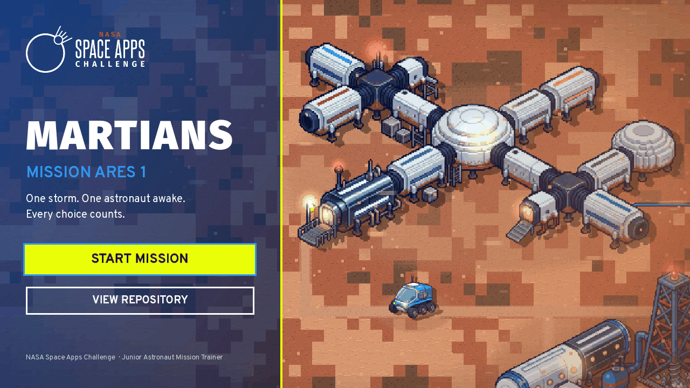
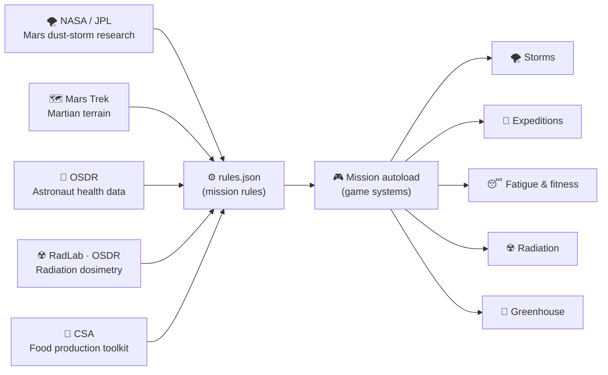
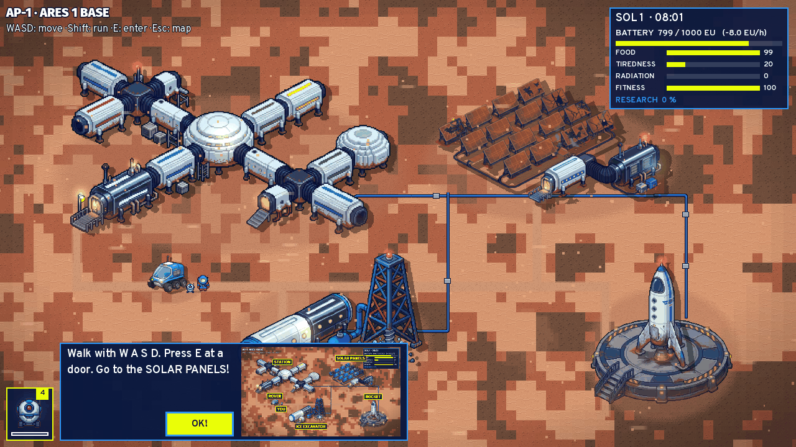
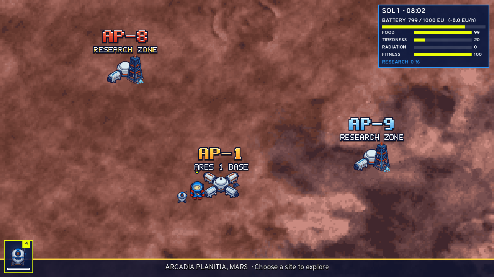
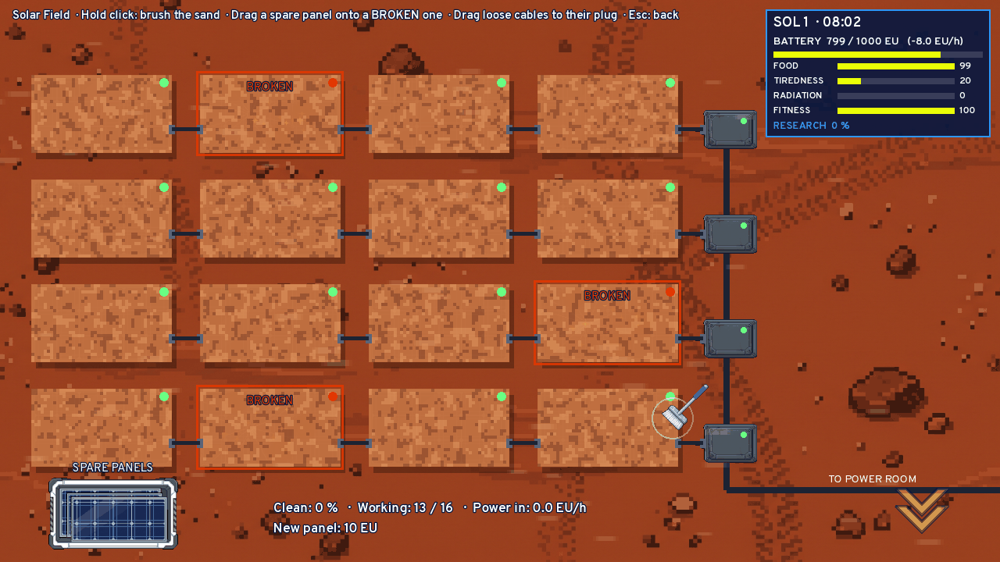
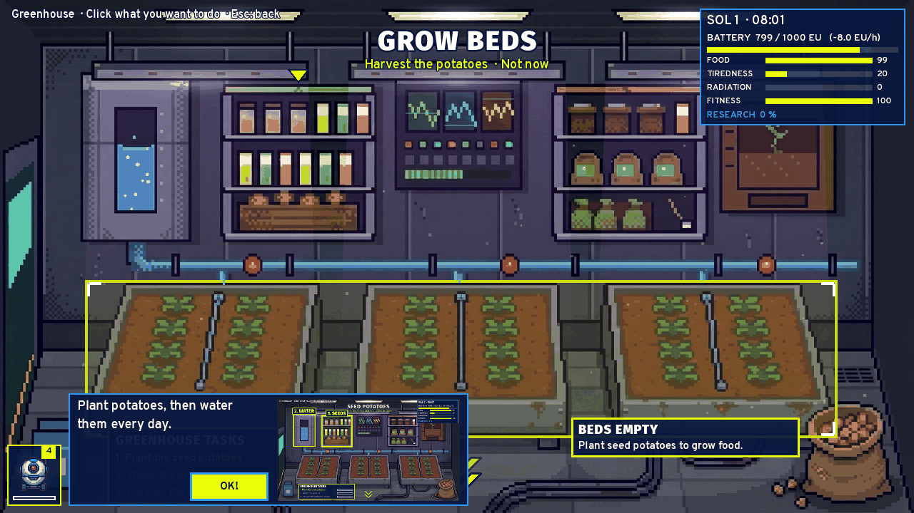
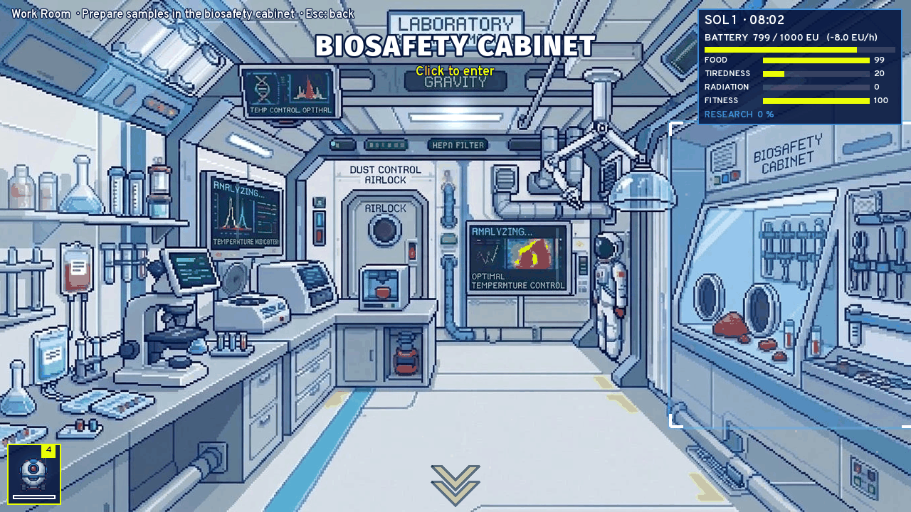
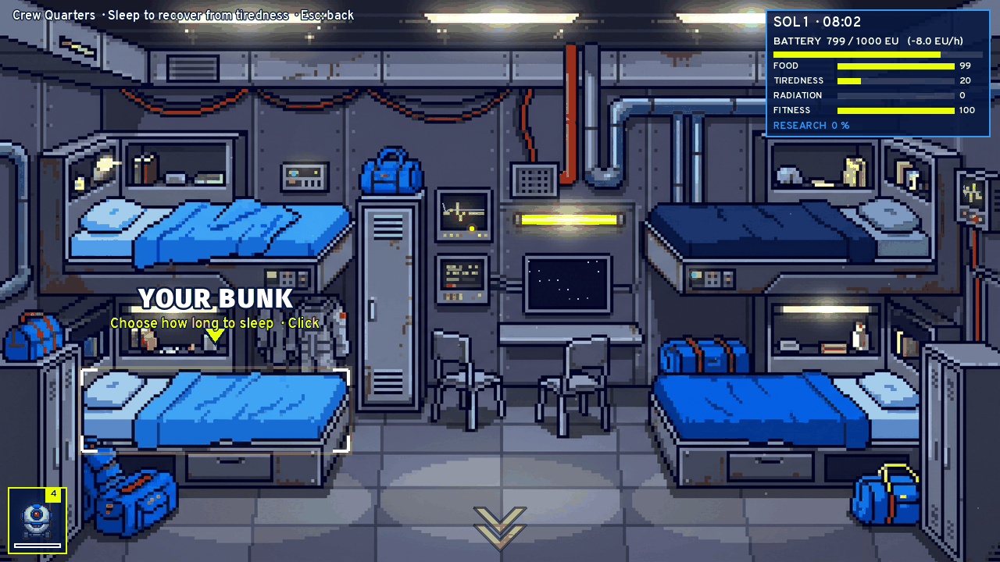

<div align="center">

# 🔴 Martian by Team NanoTang

### *One storm. One astronaut awake. Every choice counts.*

An educational 2D survival & strategy game about saving **Mission Ares 1** on Mars,
grounded in real space science for the **NASA Space Apps Challenge**.

[](https://godotengine.org/)
[](https://docs.godotengine.org/en/stable/tutorials/scripting/gdscript/index.html)
[](https://www.spaceappschallenge.org/)
[](#-built-with)
[](https://www.asc-csa.gc.ca/eng/youth-educators/toolkits/food-production/)

### 🎮 [▶ PLAY NOW IN YOUR BROWSER](https://etiensro.github.io/Martians-NasaSpaceAppsChallenge/)

[](https://etiensro.github.io/Martians-NasaSpaceAppsChallenge/)



</div>

---

## 📑 Table of Contents

1. [🚀 About the Project](#-about-the-project)
2. [✨ Key Features](#-key-features)
3. [🛰️ NASA & Space Agency Data Integration](#️-nasa--space-agency-data-integration)
4. [📸 Gallery](#-gallery)
5. [🛠️ Built With](#️-built-with)
6. [⚙️ Getting Started / Installation](#️-getting-started--installation)
7. [🎮 How to Play](#-how-to-play)
8. [👩‍🚀 Team NanoTang](#-team-nanotang)
9. [📚 References](#-references)
10. [🙏 Acknowledgments](#-acknowledgments)

---

## 🚀 About the Project

> *"WARNING! A massive dust storm is approaching Ares Base."* — **A.R.I.A.**, the base's AI

Ares Base, the **Mission Ares 1** colony at **Arcadia Planitia**, is home to a crew of four: an
**Engineer**, a **Biologist**, a **Medic** and an **Astrophysicist**. Suddenly, the base AI
**A.R.I.A.** raises the alarm: a **massive dust storm** will hit the base in 2 hours, and about
**75 % of the solar panel array** will be damaged or rendered inoperable.

The remaining 25 % of the array can sustain **only one crew member**. The crew decides that
**three of them will enter the cryogenic pods**, while one stays awake to maintain the base and monitor
the sleepers' vital systems. A.R.I.A. calculates that, with careful energy management, the reserves
can sustain the remaining astronaut for **60 sols**.

**You choose who stays awake.** When the storm passes, the base is yours: the solar panels are dusty
and broken, and the batteries are draining. You must keep Ares Base running for **60 sols** while you
finish the **research**: extract ice samples from the three research zones (**AP-1, AP-8 and AP-9**),
bring them to the **Work Room** and analyze them until the research bar reaches **100 %**.

Every action costs **time, energy or health**. Martian is not about reflexes; it is about
**planning under real constraints**, the same trade-offs that real mission planners face:

- 🔋 Do you spend 20 EU on a medical check-up, or save it for the night?
- 🥔 Do you plant potatoes now (8 sols to harvest), or leave on an expedition?
- 🌪️ A storm is coming in 6 hours: clean the panels, or shelter inside?

### 🏁 How the mission ends
- 🏆 **MISSION COMPLETE:** you keep Ares Base running until the end of the **60 sols**. The more
  research you finished, the higher your score.
- 🛑 **MISSION OVER:** the mission ends early if:
  - 🔋 **the battery runs out** (without power, the base can't keep the crew safe);
  - 🍽️ **hunger drops to 0**;
  - 😴 **fatigue reaches 100**;
  - ☢️ **radiation reaches 100** (you have to leave Mars to get medical care).

Either way, the final screen shows why the mission ended and your **score**, so every run counts.

### 🧮 Scoring
Science weighs the most:

```
P = 10·I + H + (100 − C) + E/10 + F + D
```

| Variable | Meaning | Contribution |
|---|---|---|
| **I** | Research progress (0–100 %) | 0–1,000 points |
| **H** | Hunger bar (0–100) | 0–100 points |
| **C** | Fatigue (0–100) | 0–100 points |
| **E** | Stored energy (0–1,000 EU) | 0–100 points |
| **F** | Fitness (0–100) | 0–100 points |
| **D** | Sols remaining (0–60) | 0–60 points |

> **Example:** hunger 80, fatigue 30, 600 EU, fitness 70, research 75 % and 10 sols left
> → `750 + 80 + 70 + 60 + 70 + 10 = 1,040` points. Research alone gives 750 of them.

---

## ✨ Key Features

### 🔋 1. Dynamic energy management & solar panel maintenance
- The base runs on a **1,000 EU battery** fed by a **4 × 4 solar field** (16 panels).
- Life support, cryo pods, greenhouse and auxiliary systems drain energy every hour. You decide what
  to switch off in the **Power Room**.
- Panels collect Martian dust every sol. Grab the brush and **clean them by hand**, **drag spare
  panels** onto broken ones and **reconnect cut cables**.
- Solar input scales with how many panels work **and** how clean they are. Neglect the field and the
  lights go out.

### 🌱 2. Food production in the greenhouse
- Plant potatoes, **water them every sol** and harvest them after an **8-sol growth cycle**
  (24 potatoes per harvest).
- Skipping waterings costs you: 1 dry sol means −10 % yield, 2 sols −25 %, 3 sols −50 %, and after
  4 sols the crop dies.
- You start with 30 meals in the pantry. Every potato is one more meal, and before each expedition you
  choose how many meals to load in the rover (up to 6).
- Inspired by the **Canadian Space Agency's _Food production on the Moon and in remote areas_**
  educational toolkit.

### 🚙 3. Rover exploration & ice extraction
- A **top-down** exterior: walk around the AP-1 colony and drive the rover across the planet map at
  **10 km/h**.
- Travel to **AP-8 (6.5 h)** and **AP-9 (6 h)**. Inspect and maintain the rover, pack your meals and
  check that the base has energy for the time you're away.
- In each zone, first **clean the dusty panels of the mini base**, then use the **ice drill**
  (mini-game). The drill works for 24 h, and you can rest in the rover while it works.
- Bring the sample back to the **Work Room** and analyze it for **72 hours** (+4 EU/h). Each zone
  (AP-1, AP-8 and AP-9) adds about **33 %** to the research.

### 🩺 4. Crew health monitoring
| Bar | How it changes | How to recover |
|---|---|---|
| 🍽️ **Hunger** | −6 per sol | Eat in the station (max. 1 meal every 5 h) |
| 😴 **Fatigue** | +4 per hour awake | Sleep in the dormitory (−9 per hour) |
| ☢️ **Radiation** | +1/h indoors, **+4/h outdoors** | Only a medical check-up in the infirmary (−30) |
| 💪 **Fitness** | −15 per sol without exercise | Treadmill session in the gym (+20, once per sol) |

High hunger, fatigue or radiation make **every task slower**, and low fitness slows physical work.
If any bar reaches its limit, the mission ends.

### 🌪️ 5. Storms with real consequences
| Storm | Duration | Solar loss | Effect |
|---|---|---|---|
| 🟡 Light | 12 h | −20 % | Light dust on the panels |
| 🟠 Moderate | 24 h | −45 % | Heavy dust, **lockdown**, greenhouse damaged |
| 🔴 Intense | 48 h | −70 % | Dust, **broken panels and cut cables**, greenhouse and rover damaged |

A.R.I.A. warns you **6 hours** in advance. Use that time wisely.

### 🧑‍🚀 6. Four playable astronauts
Each crew member is named after a **real astronaut** and has **perks** linked to their profession, so
every run plays differently. Each role card also teaches a real space fact:

| Role | Crew member | Perks | Space fact on the card |
|---|---|---|---|
| 🔧 **Engineer**: *"Keeps the machines alive."* | Mark L. Polansky | Repair and maintenance speed **+25 %** · uses **10 % less energy** | Real Mars bases would run on solar panels, batteries and maybe small nuclear reactors. |
| 🌱 **Biologist**: *"Grows food and fresh air."* | Jessica U. Meir | Harvest yields **+25 %** · crops grow **15 % faster** | Plants turn carbon dioxide into oxygen. Astronauts have grown lettuce on the ISS! |
| 🩺 **Medic**: *"Keeps everyone healthy."* | Story Musgrave | Medical diagnosis uses **no energy** · recovers **50 % faster** | Astronauts lose bone and muscle in low gravity, so they exercise about 2 hours every day. |
| 🔭 **Astrophysicist**: *"Reads the sky and the Sun."* | David Saint-Jacques | Research speed **+25 %** · extraction speed **+25 %** | NASA watches the Sun every day to warn astronauts about dangerous solar storms. |

The other three crew members stay in the **cryo bay**, and **A.R.I.A.**, the base's AI robot, guides you.

### 🧩 7. More highlights
- **Time that matters:** 1 real minute = 1 in-game hour. Long activities such as sleeping or
  traveling fast-forward the clock, while every bar and event keeps updating hour by hour.
- **A.R.I.A., the robot guide**, shows your day-1 tasks with a progress bar (fix the panels, plant and
  water potatoes, exercise), gives short illustrated lessons for kids, and explains *why* a door
  is locked.
- **Two perspectives, one art style.** The art is inspired by the high-density **16-bit arcade pixel
  art of the 90s** (Neo Geo / "Hi-Bit", in the spirit of *Metal Slug*). The exterior uses a
  **top-down view**, and the colony interiors switch to a **first-person visual-novel view**, with one
  scene per area: station hub, work room, greenhouse, gym, infirmary, dormitory, solar hub and power room.
- **Data-driven design:** every number in the game lives in a single file,
  [`data/mission/rules.json`](data/mission/rules.json), so the science can be re-balanced without
  touching code.

---

## 🛰️ NASA & Space Agency Data Integration

> **Real science, playable.** Martian's rules are based on NASA and CSA resources, so each
> decision a player makes mirrors a real problem of a crewed Mars mission.



| Source | What we took from it | How it shapes gameplay | Where in the game |
|---|---|---|---|
| 🌪️ **NASA / JPL Mars dust-storm research** (see [References](#-references)) | How Martian dust storms form, how often they occur and how they block sunlight | Random storms: **15 % daily chance** after a **3-sol safe period**, three intensities (light 50 %, moderate 30 %, intense 20 %), 12/24/48 h long, with solar loss of −20/−45/−70 %. A.R.I.A. warns **6 hours** in advance. Moderate and intense storms force a **lockdown**, and afterwards the damaged systems must be repaired | `storms` in `rules.json` · `Mission` storm system · A.R.I.A. warnings |
| 🗺️ **[Mars Trek](https://trek.nasa.gov/mars/)** | Real images of the Martian surface, altitudes and terrain data from NASA missions (including Curiosity and Perseverance) | The **Arcadia Planitia** world map and its research zones: AP-8 (*knobby terrain and craters*) and AP-9 (*pingos and mounds, signs of ice under the ground*). At a rover speed of **10 km/h** (based on NASA rover studies), trips take **6.5 h** (AP-8) and **6 h** (AP-9) each way. Those hours cost food, energy and radiation | World map · `expeditions` in `rules.json` |
| 🧬 **[OSDR](https://osdr.nasa.gov/bio/repo/)** (NASA Open Science Data Repository, [search API](https://osdr.nasa.gov/osdr/data/search?term=KEYWORD)) | NASA's public archive on space biology and astronaut health: how spaceflight affects bone density, muscle mass, immune response, sleep and more | **Fatigue** grows +4/h awake and drops −9/h asleep, which allows a 16 h awake / 8 h asleep routine. Above 50 and 80, task penalties are ×1.10 and ×1.35. **Fitness** drops −15 per sol without exercise and only recovers +20 per 2-hour session, just like the daily exercise on the ISS | `crew.fatigue` and `crew.fitness` in `rules.json` · Dormitory · Gym |
| ☢️ **[RadLab](https://visualization.osdr.nasa.gov/radlab/gui/data-api/)** (OSDR Radiation Dosimetry Database) | Real radiation dose measurements from dosimeters aboard the ISS, contributed by several space agencies (e.g. absorbed dose rate) | **Radiation risk** builds up **4× faster outdoors** (+4/h vs. +1/h indoors). Resting does not lower it: only a **medical check-up** (20 EU, 4 h, −30). Above 25 there is a medical warning, above 50 and 75 tasks slow down (×1.15 and ×1.35), and at 100 the mission ends | `crew.radiation` in `rules.json` · Infirmary scan mini-game |
| 🥔 **[CSA: Food production on the Moon and in remote areas](https://www.asc-csa.gc.ca/eng/youth-educators/toolkits/food-production/)** (Canadian Space Agency) | Educational toolkit on how food production in space relates to astronaut health and nutrition | Greenhouse potato crop: **8-sol** growth, daily watering, **24 potatoes** per harvest, yield loss for every dry sol and **3 meals per sol** to balance hunger | `crops` and `food` in `rules.json` · Greenhouse |

**Scientific storytelling inside the game:**
- The intro references the real **2018 global dust storm** that ended NASA's **Opportunity** rover
  mission. This is the same threat Ares 1 faces.
- Each role card includes a **real space fact** (low-gravity muscle loss, plants making oxygen on the
  ISS, power sources for Mars bases, Sun monitoring).
- A.R.I.A.'s lessons turn the daily routine into habits kids can understand: clean the panels, water
  the plants, exercise, eat and sleep.

> 🔬 **Transparency note:** the data is used at **design time** to calibrate the values in
> [`data/mission/rules.json`](data/mission/rules.json). The game runs fully **offline**, with no live
> API calls during play. Every calibrated value and every team decision (`_proposed` fields) is
> documented in [`docs/SISTEMAS_DE_MISION.md`](docs/SISTEMAS_DE_MISION.md).
>
> ☢️ **Scientific note:** in reality, an accumulated radiation dose does not disappear by going indoors.
> In the game, the radiation bar is a **simplified exposure-and-risk indicator** that rewards regular
> medical monitoring. It is not a literal dose counter.

---

## 📸 Gallery

<table>
  <tr>
    <td align="center"><br><sub><b>Intro:</b> the storm is coming, and three crew members enter cryosleep</sub></td>
    <td align="center"><br><sub><b>AP-1 colony:</b> top-down arcade exploration</sub></td>
  </tr>
  <tr>
    <td align="center"><br><sub><b>World map:</b> Arcadia Planitia, with the AP-1, AP-8 and AP-9 zones</sub></td>
    <td align="center"><br><sub><b>Ares 1 station:</b> first-person hub</sub></td>
  </tr>
  <tr>
    <td align="center"><br><sub><b>Solar field:</b> brush off the dust and replace broken panels</sub></td>
    <td align="center"><br><sub><b>Power room:</b> switch systems on and off to manage the battery</sub></td>
  </tr>
  <tr>
    <td align="center"><br><sub><b>Greenhouse:</b> plant, water and harvest potatoes</sub></td>
    <td align="center"><br><sub><b>Ice drill:</b> extract subsurface ice samples</sub></td>
  </tr>
  <tr>
    <td align="center"><br><sub><b>Medical bay:</b> radiation check-ups</sub></td>
    <td align="center"><br><sub><b>Laboratory:</b> analyze the ice for 72 h</sub></td>
  </tr>
  <tr>
    <td align="center"><br><sub><b>Gym:</b> treadmill mini-game against muscle loss</sub></td>
    <td align="center"><br><sub><b>Dormitory:</b> choose how many hours to sleep</sub></td>
  </tr>
</table>

---

## 🛠️ Built With

| Category | Tools |
|---|---|
| 🎮 **Game engine** | [Godot Engine 4.7](https://godotengine.org/) (GL Compatibility renderer, 1280 × 720) |
| 💻 **Language** | GDScript |
| 🎨 **Pixel art** | [Aseprite](https://www.aseprite.org/) · [Piskel](https://www.piskelapp.com/): 16-bit style, nearest-neighbor filtering |
| 🐍 **Asset pipeline** | Python 3 + [NumPy](https://numpy.org/) + [Pillow](https://python-pillow.org/): scripts in [`tools/`](tools/) that crop, scale and palette-match the art and generate sprite sheets, collision data and JSON metadata |
| 🤖 **AI assistants** | **[Claude](https://www.anthropic.com/claude)** (Anthropic): coding help, game logic integration and documentation · **[Gemini](https://gemini.google.com/)** (Google): concept art and base images, later cleaned up as pixel art |
| 🛰️ **Space agency data** | NASA Mars Trek · OSDR · RadLab · NASA/JPL dust-storm research · CSA Food Production toolkit |
| 🔤 **Fonts** | Fira Sans Black & Overpass (SIL Open Font License), following the [Space Apps brand guide](https://www.spaceappschallenge.org/brand/) |
| 🌿 **Version control** | Git + GitHub (feature branches → `develop` → `main`) |

---

## ⚙️ Getting Started / Installation

### 🌐 Play online (no download)
Open **https://etiensro.github.io/Martians-NasaSpaceAppsChallenge/** in a desktop browser. No
installation or account is needed.

### 💻 Run it from the source code

#### Prerequisites
- **[Godot Engine 4.7](https://godotengine.org/download/)** or newer (standard version; .NET is not required)
- **Git**
- *(Optional, only to rebuild the art)* **Python 3.10+** with `numpy` and `pillow`

#### 1. Clone the repository
```bash
git clone https://github.com/Etiensro/Martians-NasaSpaceAppsChallenge.git
```

#### 2. Open it in Godot
1. Launch Godot and click **Import**.
2. Select the `project.godot` file inside the cloned folder.
3. Click **Import & Edit**. The first import may take a minute while Godot processes the assets.

#### 3. Play
Press **F5** (or the ▶️ *Run Project* button). The game starts at the main menu
(`scenes/intro/main_menu.tscn`).

#### 4. *(Optional)* Rebuild the art assets
```bash
pip install numpy pillow
```
```bash
python tools/build_colony.py
```
Each `tools/build_*.py` script regenerates one group of assets. See
[`docs/GUIA_DEL_PROYECTO.md`](docs/GUIA_DEL_PROYECTO.md) for the full list.

> 📦 **Exporting:** add `*.json` under *Export → Resources → Filters to export non-resource files*,
> because the mission rules and dialogues are loaded at runtime.

---

## 🎮 How to Play

### ⌨️ Controls
| Action | Key |
|---|---|
| Move | `W` `A` `S` `D` / Arrow keys |
| Run | `Shift` |
| Enter a building / use the rover | `E` |
| Back / leave a room | `Esc` |
| Interact in interiors and mini-games | Mouse (click, hold and drag) |
| Mini-game actions (treadmill, drill) | `Space` / on-screen hints |
| Ask A.R.I.A. for help | Click the robot (bottom-left) |

### 🧭 Survival tips
1. 🔆 **Fix the solar field first.** The mission starts with dusty and broken panels. No sun, no
   power, no mission.
2. 🔌 **Turn off what you don't need.** Before an expedition, switch off lights & auxiliary systems
   in the Power Room.
3. 🥔 **Plant early, water daily.** A crop takes 8 sols, and 4 dry sols in a row kill it.
4. ☢️ **Watch your radiation.** Being outside costs 4× more. Plan expeditions and book a check-up
   when you come back.
5. 💪 **Train every sol.** Low fitness makes repairs and extraction much slower.
6. 😴 **Sleep before you're exhausted.** Above 80 fatigue, everything takes 35 % longer.
7. 🌪️ **When A.R.I.A. warns of a storm, prepare.** Charge the battery, clean the panels and get
   inside. Intense storms break things.
8. 🧪 **Science wins.** Research is worth 10 points per percent: visit all three zones.

---

## 👩‍🚀 Team NanoTang

### 👥 Members

| | Name |
|---|---|
| 🧑‍🚀 | **Melyssa Francisco Cortez** |
| 🧑‍🚀 | **Gricelda Analyn Cruz Sanchez** |
| 🧑‍🚀 | **Etienne Hernandez Ordaz** |
| 🧑‍🚀 | **Manuel Teodoro Garcia Gonzalez** |
| 🧑‍🚀 | **Kim Seungmin** |

### 🧩 Disciplines

A multidisciplinary team that brought together:

| Discipline | Contribution |
|---|---|
| 🧠 **Game design** | Mission rules, balancing and progression |
| 💻 **Programming** | Godot systems: time, energy, crew health, crops, expeditions, storms and scoring |
| 🎨 **Pixel art & UI** | Characters, colony, interiors, HUD and the asset pipeline |
| 🔬 **Science & data research** | Translating NASA and CSA data (Mars Trek, OSDR, RadLab, dust-storm research, food production) into game rules |
| 📖 **Narrative & education** | Story, A.R.I.A.'s lessons and the real space facts for young players |

See everyone who contributed on the
[contributors page](https://github.com/Etiensro/Martians-NasaSpaceAppsChallenge/graphs/contributors).

---

## 📚 References

### 🛰️ Data sources
- NASA Mars Trek: https://trek.nasa.gov/mars/
- NASA Open Science Data Repository (OSDR): https://osdr.nasa.gov/bio/repo/ · search API: https://osdr.nasa.gov/osdr/data/search?term=KEYWORD
- RadLab, OSDR Radiation Dosimetry Database: https://visualization.osdr.nasa.gov/radlab/gui/data-api/
- Canadian Space Agency, *Food production on the Moon and in remote areas*: https://www.asc-csa.gc.ca/eng/youth-educators/toolkits/food-production/

### ☢️ Space radiation
- NASA, Human Health and Performance: Space Radiation: https://www.nasa.gov/directorates/esdmd/hhp/space-radiation
- NASA Science, Radiation exposure comparisons with Mars trip calculation: https://science.nasa.gov/resource/radiation-exposure-comparisons-with-mars-trip-calculation
- National Academies of Sciences, Engineering, and Medicine: https://www.nationalacademies.org/read/28594/chapter/4#22
- NASA, Real Martians: How to protect astronauts from space radiation on Mars: https://www.nasa.gov/science-research/heliophysics/real-martians-how-to-protect-astronauts-from-space-radiation-on-mars
- NASA Science, Radiation measurements on Mars: https://science.nasa.gov/resource/radiation-measurements-on-mars

### 🌪️ Martian dust storms
- NASA, The fact and fiction of Martian dust storms: https://www.nasa.gov/solar-system/the-fact-and-fiction-of-martian-dust-storms/?site=insight
- NASA JPL, NASA Mars orbiters reveal seasonal dust storm pattern: https://www.jpl.nasa.gov/news/nasa-mars-orbiters-reveal-seasonal-dust-storm-pattern/
- *Icarus* (ScienceDirect): https://www.sciencedirect.com/science/article/pii/S0019103518301106
- NASA Technical Reports Server, Mars surface operations: https://ntrs.nasa.gov/api/citations/20220000589/downloads/MarsSAC21SurfaceOps_2022-Jan_Version%201%20FINAL_update.pdf

### 🚙 Rover and exploration
- NASA Technical Reports Server (rover speed): https://ntrs.nasa.gov/citations/19940021211

### 🧊 Subsurface ice and Mars science (bibliography)
- AGU, *Journal of Geophysical Research: Planets*, doi:10.1029/2024JE008724: https://agupubs.onlinelibrary.wiley.com/doi/10.1029/2024JE008724
- USGS Publications Warehouse: https://pubs.usgs.gov/publication/70266466
- NASA Scientific Visualization Studio: https://svs.gsfc.nasa.gov/14866/#media_group_378959

### 👩‍🚀 Crew inspirations
The four crew members are named after real NASA and CSA astronauts: Mark L. Polansky (Engineer),
Jessica U. Meir (Biologist), Story Musgrave (Medic) and David Saint-Jacques (Astrophysicist).

---

## 🙏 Acknowledgments

- 🚀 **[NASA Space Apps Challenge](https://www.spaceappschallenge.org/)**, for the challenge and the
  inspiration.
- 🍁 The **Canadian Space Agency (CSA)**, for its educational food production toolkit.
- 🛰️ **NASA** open data and tools: [Mars Trek](https://trek.nasa.gov/mars/),
  [OSDR](https://osdr.nasa.gov/bio/repo/) and [RadLab](https://visualization.osdr.nasa.gov/radlab/gui/data-api/).
- 🎮 **[Godot Engine](https://godotengine.org/)** and its community.
- 🎨 **Aseprite**, **Piskel**, **NumPy** and **Pillow**.
- 🔤 **Fira Sans** and **Overpass** fonts (SIL Open Font License).
- 🤖 **Claude** (Anthropic) and **Gemini** (Google), our AI assistants.

> ⚠️ This is a fan-made educational project. It is **not** affiliated with or endorsed by NASA. Only
> the NASA Space Apps Challenge logo is used, in accordance with its
> [brand guidelines](https://www.spaceappschallenge.org/brand/).

<div align="center">

---

**Made with ❤️ and a lot of Martian dust by Team NanoTang** 🔴

</div>
