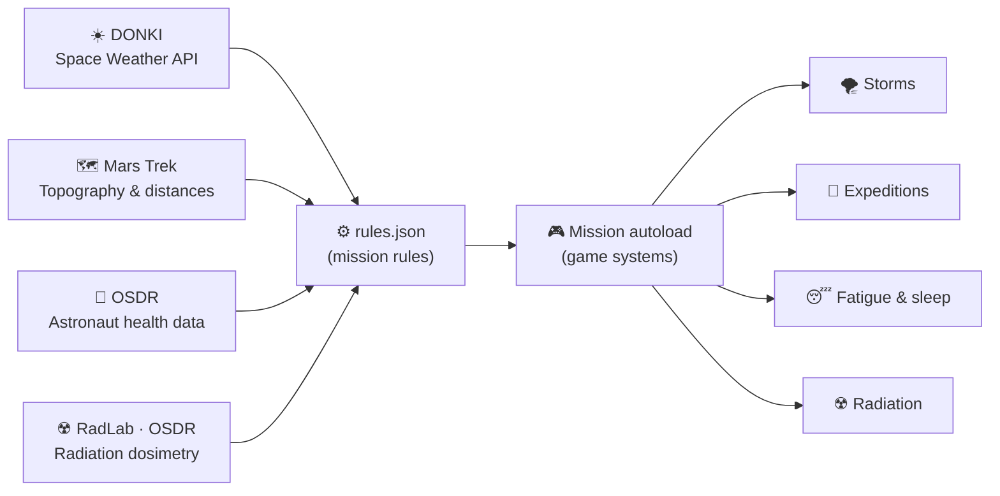
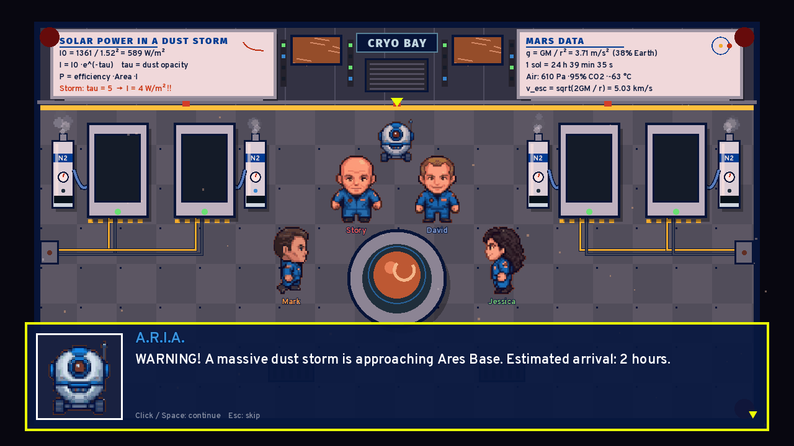
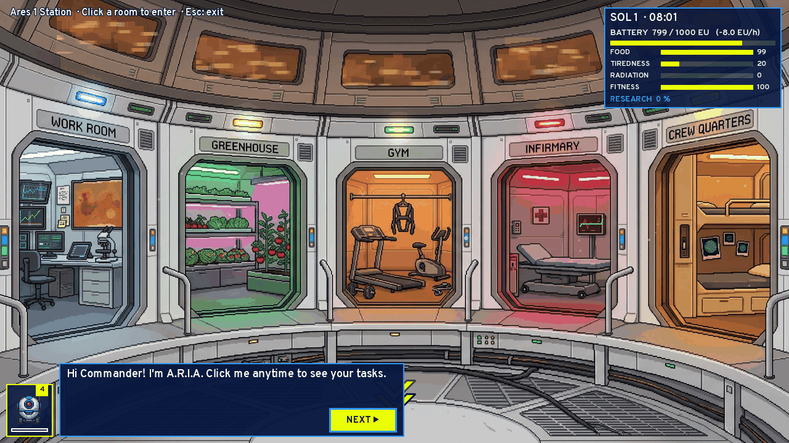
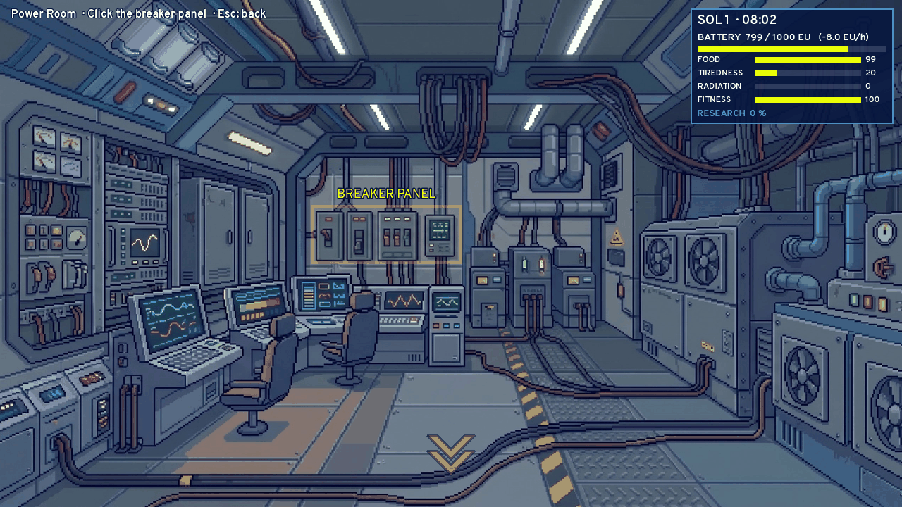
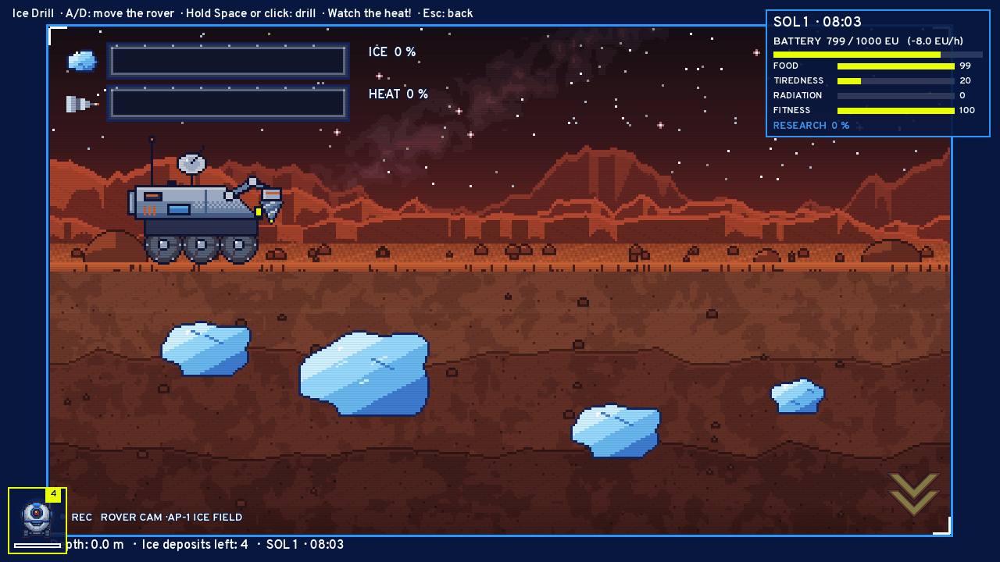
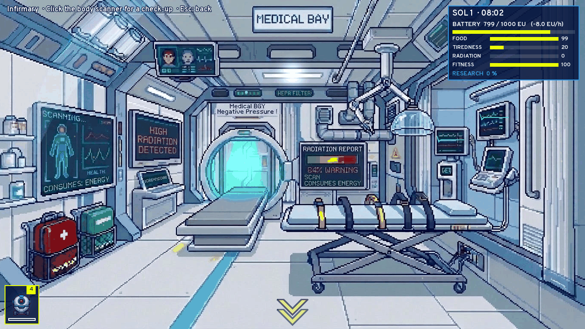
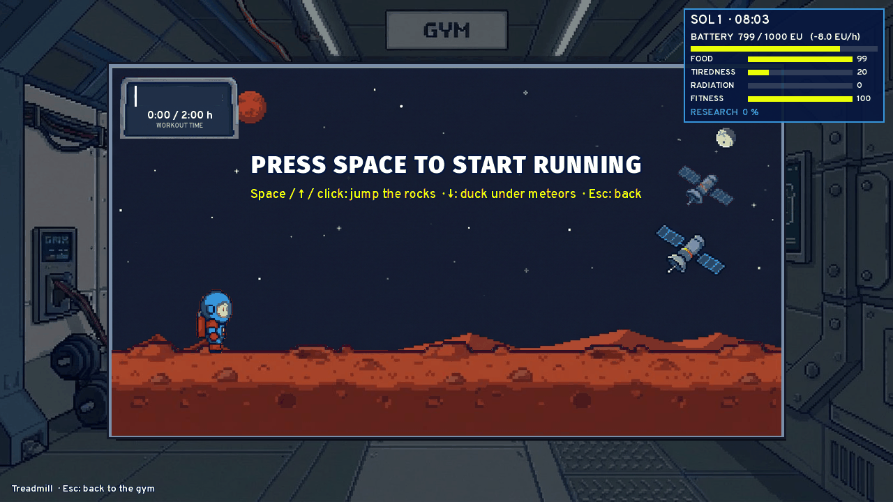

<div align="center">

# 🔴 Martian by Team NanoTang

### *One storm. One astronaut awake. Every choice counts.*

An educational 2D survival & strategy game about saving **Mission Ares 1** on Mars,
built on real NASA science for the **NASA Space Apps Challenge**.

[](https://godotengine.org/)
[](https://docs.godotengine.org/en/stable/tutorials/scripting/gdscript/index.html)
[](https://www.spaceappschallenge.org/)
[](#-built-with)
[](#-acknowledgments--license)


</div>

---

## 📑 Table of Contents

1. [🚀 About the Project](#-about-the-project)
2. [✨ Key Features](#-key-features)
3. [🛰️ NASA & Space Agency Data Integration](#️-nasa--space-agency-data-integration)
4. [📸 Gallery](#-gallery)
5. [🛠️ Built With](#️-built-with)
6. [⚙️ Getting Started / Installation](#️-getting-started--installation)
7. [🎮 How to Play](#-how-to-play)
8. [👩‍🚀 Team NanoTang](#-team-nanotang)
9. [🙏 Acknowledgments / License](#-acknowledgments--license)

---

## 🚀 About the Project

> *"WARNING! A massive dust storm is approaching Ares Base."* — **A.R.I.A.**, the base's AI

A **global dust storm** has swept across Mars. When it clears, the Ares 1 base at **Arcadia Planitia**
is in ruins: the solar field is buried in dust, several panels are broken and the batteries are
draining. Only **one astronaut** wakes up from cryosleep, while the rest of the crew stays frozen in
the cryo bay.

You choose who wakes up (**Engineer, Biologist, Medic or Astrophysicist**, each inspired by a real
NASA astronaut). Then you must keep the base alive for **60 sols** (Martian days) while completing
the mission's scientific goal: **extracting and analyzing subsurface ice** from three research
zones (AP-1, AP-8 and AP-9).

Every action costs **time, energy or health**. Martian is not about reflexes; it is about
**planning under real constraints**, the same trade-offs that real mission planners face:

- 🔋 Do you spend 20 EU on a medical check-up, or save it for the night?
- 🥔 Do you plant potatoes now (8 sols to harvest), or leave on an expedition?
- 🌪️ A storm is coming in 6 hours: clean the panels, or shelter inside?

**🎯 Goal:** survive all 60 sols and reach **100 % research**. Your final score rewards science first:

```
Score = 10 × Research % + Hunger + (100 − Fatigue) + Energy / 10 + Fitness + Sols remaining
```

---

## ✨ Key Features

### 🔋 1. Dynamic energy management & solar panel maintenance
- The base runs on a **1,000 EU battery** fed by a **4 × 4 solar field** (16 panels).
- Life support, cryo pods, greenhouse and auxiliary systems drain energy every hour. You decide what
  to switch off in the **Power Room**.
- Panels collect Martian dust every sol. Grab the brush and **clean them by hand**, **drag spare
  panels** onto broken ones and **reconnect cut cables**.
- Solar input scales with how many panels work **and** how clean they are. Neglect the field and the
  lights go out.

### 🌱 2. Food production in the greenhouse
- Plant potatoes, **water them every sol** and harvest them after an **8-sol growth cycle**
  (24 potatoes per harvest).
- Skipping waterings costs you: 1 dry sol means −10 % yield, 2 sols −25 %, 3 sols −50 %, and after
  4 sols the crop dies.
- You start with 30 meals in the pantry. Every potato is one more meal.

### 🚙 3. Rover exploration & ice extraction
- A **top-down, Neo Geo arcade-style** exterior: walk around the AP-1 colony and drive the
  rover across the planet map at **10 km/h**.
- Travel to **AP-8 (6.5 h)** and **AP-9 (6 h)**. Inspect and maintain the rover, pack your meals and
  check that the base has energy for the time you're away.
- Deploy the **ice drill** in a mini-game, bring the sample home and analyze it in the lab for
  **72 hours**. Each zone adds ~33 % to the research goal.

### 🩺 4. Crew health monitoring
| Bar | How it changes | How to recover |
|---|---|---|
| 🍽️ **Hunger** | −6 per sol | Eat in the station (max. 1 meal every 5 h) |
| 😴 **Fatigue** | +4 per hour awake | Sleep in the dormitory (−9 per hour) |
| ☢️ **Radiation** | +1/h indoors, **+4/h outdoors** | Only a medical check-up in the infirmary (−30) |
| 💪 **Fitness** | −15 per sol without exercise | Treadmill session in the gym (+20, once per sol) |

High hunger, fatigue or radiation make **every task slower**, and low fitness slows physical work.
If any bar reaches its limit, the mission ends.

### 🌪️ 5. Storms with real consequences
| Storm | Duration | Solar loss | Effect |
|---|---|---|---|
| 🟡 Light | 12 h | −20 % | Light dust on the panels |
| 🟠 Moderate | 24 h | −45 % | Heavy dust, **lockdown**, greenhouse damaged |
| 🔴 Intense | 48 h | −70 % | Dust, **broken panels and cut cables**, greenhouse and rover damaged |

A.R.I.A. warns you **6 hours** in advance. Use that time wisely.

### 🧑‍🚀 6. More highlights
- **Four playable roles** with real gameplay perks: the Engineer repairs faster and uses less energy,
  the Biologist grows more food, the Medic heals faster and for free, and the Astrophysicist does
  research and extraction faster.
- **Time that matters:** 1 real minute = 1 in-game hour. Long activities such as sleeping or
  traveling fast-forward the clock, while every bar and event keeps updating hour by hour.
- **A.R.I.A., the robot guide**, gives day-1 tasks and short illustrated lessons for kids, and
  explains *why* something is locked.
- **First-person "visual novel" interiors**: station hub, work room, greenhouse, gym, infirmary,
  dormitory, solar hub and power room.
- **Data-driven design:** every number in the game lives in a single file,
  [`data/mission/rules.json`](data/mission/rules.json), so the science can be re-balanced without
  touching code.

---

## 🛰️ NASA & Space Agency Data Integration

> **Real science, playable.** Every critical rule in Martian is calibrated with NASA open data, so
> each decision a player makes mirrors a real problem of a crewed Mars mission.



| NASA source | What we took from it | How it shapes gameplay | Where in the game |
|---|---|---|---|
| ☀️ **[DONKI](https://kauai.ccmc.gsfc.nasa.gov/DONKI/)** (Space Weather Database Of Notifications, Knowledge, Information) | Frequency and severity distribution of recorded space-weather events | Sets the **daily storm probability (15 %)**, the **three intensity tiers** (light 50 %, moderate 30 %, intense 20 %), their duration (12/24/48 h) and solar loss (−20/−45/−70 %). Also gives a **3-sol safe period** at the start and a **6-hour early warning**, like real forecasting | `storms` in `rules.json` · `Mission` storm system · A.R.I.A. warnings |
| 🗺️ **[Mars Trek](https://trek.nasa.gov/mars/)** | Topographic mapping and surface distances between sites | Places the base and the research zones on the planet map. Distances at a rover speed of **10 km/h** give real travel times: **AP-8 = 6.5 h**, **AP-9 = 6 h** each way. These hours cost food, energy and radiation | World map · `expeditions` in `rules.json` |
| 🧬 **[OSDR](https://osdr.nasa.gov/bio/)** (NASA Open Science Data Repository) | Studies on astronaut sleep, fatigue and muscle loss in reduced gravity | **Fatigue** grows +4/h awake and drops −9/h asleep. Above 50 and 80, task penalties are ×1.10 and ×1.35. **Fitness** drops −15 per sol without exercise, which forces treadmill sessions, just like on the ISS | `crew.fatigue` and `crew.fitness` in `rules.json` · Dormitory · Gym |
| ☢️ **[RadLab](https://osdr.nasa.gov/bio/)** (OSDR radiation data) | Cumulative radiation dose on the Martian surface vs. indoors | **Radiation** builds up **4× faster outdoors** (+4/h vs. +1/h). It never drops on its own; only a medical check-up lowers it. Above 50 and 75 all tasks slow down, and at 100 the mission ends | `crew.radiation` in `rules.json` · Infirmary scan mini-game |

**Scientific storytelling inside the game:**
- The intro references the real **2018 global dust storm** that ended NASA's **Opportunity** rover
  mission. This is the same threat Ares 1 faces.
- Each role card includes a **real space fact** (for example, how NASA monitors the Sun to protect
  astronauts from solar storms).
- A.R.I.A.'s lessons explain *why* each rule exists (radiation, low-gravity muscle loss, dust on
  solar panels).

> 🔬 **Transparency note:** the data is used at **design time** to calibrate the values in
> [`data/mission/rules.json`](data/mission/rules.json). The game runs fully **offline**, with no live
> API calls during play. Every calibrated value and every team decision (`_proposed` fields) is
> documented in [`docs/SISTEMAS_DE_MISION.md`](docs/SISTEMAS_DE_MISION.md).

---

## 📸 Gallery

<table>
  <tr>
    <td align="center"><br><sub><b>Intro:</b> the storm hits, and only one astronaut wakes up</sub></td>
    <td align="center"><br><sub><b>AP-1 colony:</b> top-down arcade exploration</sub></td>
  </tr>
  <tr>
    <td align="center"><br><sub><b>World map:</b> Arcadia Planitia, with the AP-1, AP-8 and AP-9 zones</sub></td>
    <td align="center"><br><sub><b>Ares 1 station:</b> first-person hub</sub></td>
  </tr>
  <tr>
    <td align="center"><br><sub><b>Solar field:</b> brush off the dust and replace broken panels</sub></td>
    <td align="center"><br><sub><b>Power room:</b> switch systems on and off to manage the battery</sub></td>
  </tr>
  <tr>
    <td align="center"><br><sub><b>Greenhouse:</b> plant, water and harvest potatoes</sub></td>
    <td align="center"><br><sub><b>Ice drill:</b> extract subsurface ice samples</sub></td>
  </tr>
  <tr>
    <td align="center"><br><sub><b>Medical bay:</b> radiation check-ups</sub></td>
    <td align="center"><br><sub><b>Laboratory:</b> analyze the ice for 72 h</sub></td>
  </tr>
  <tr>
    <td align="center"><br><sub><b>Gym:</b> treadmill mini-game against muscle loss</sub></td>
    <td align="center"><br><sub><b>Dormitory:</b> choose how many hours to sleep</sub></td>
  </tr>
</table>

---

## 🛠️ Built With

| Category | Tools |
|---|---|
| 🎮 **Game engine** | [Godot Engine 4.7](https://godotengine.org/) (GL Compatibility renderer, 1280 × 720) |
| 💻 **Language** | GDScript |
| 🎨 **Pixel art** | [Aseprite](https://www.aseprite.org/) · [Piskel](https://www.piskelapp.com/): 16-bit style, nearest-neighbor filtering |
| 🐍 **Asset pipeline** | Python 3 + [NumPy](https://numpy.org/) + [Pillow](https://python-pillow.org/): scripts in [`tools/`](tools/) that crop, scale and palette-match the art and generate sprite sheets, collision data and JSON metadata |
| 🤖 **AI assistants** | **[Claude](https://www.anthropic.com/claude)** (Anthropic): coding help, game logic integration and documentation · **[Gemini](https://gemini.google.com/)** (Google): concept art and base images, later cleaned up as pixel art |
| 🛰️ **NASA data** | DONKI · Mars Trek · OSDR · RadLab |
| 🔤 **Fonts** | Fira Sans Black & Overpass (SIL Open Font License), following the [Space Apps brand guide](https://www.spaceappschallenge.org/brand/) |
| 🌿 **Version control** | Git + GitHub (feature branches → `develop` → `main`) |

---

## ⚙️ Getting Started / Installation

### Prerequisites
- **[Godot Engine 4.7](https://godotengine.org/download/)** or newer (standard version; .NET is not required)
- **Git**
- *(Optional, only to rebuild the art)* **Python 3.10+** with `numpy` and `pillow`

### 1. Clone the repository
```bash
git clone https://github.com/Etiensro/Martians-NasaSpaceAppsChallenge.git
```

### 2. Open it in Godot
1. Launch Godot and click **Import**.
2. Select the `project.godot` file inside the cloned folder.
3. Click **Import & Edit**. The first import may take a minute while Godot processes the assets.

### 3. Play
Press **F5** (or the ▶️ *Run Project* button). The game starts at the main menu
(`scenes/intro/main_menu.tscn`).

### 4. *(Optional)* Rebuild the art assets
```bash
pip install numpy pillow
```
```bash
python tools/build_colony.py
```
Each `tools/build_*.py` script regenerates one group of assets. See
[`docs/GUIA_DEL_PROYECTO.md`](docs/GUIA_DEL_PROYECTO.md) for the full list.

> 📦 **Exporting:** add `*.json` under *Export → Resources → Filters to export non-resource files*,
> because the mission rules and dialogues are loaded at runtime.

---

## 🎮 How to Play

### ⌨️ Controls
| Action | Key |
|---|---|
| Move | `W` `A` `S` `D` / Arrow keys |
| Run | `Shift` |
| Enter a building / use the rover | `E` |
| Back / leave a room | `Esc` |
| Interact in interiors and mini-games | Mouse (click, hold and drag) |
| Mini-game actions (treadmill, drill) | `Space` / on-screen hints |
| Ask A.R.I.A. for help | Click the robot (bottom-left) |

### 🧭 Survival tips
1. 🔆 **Fix the solar field first.** The mission starts with dusty and broken panels. No sun, no
   power, no mission.
2. 🔌 **Turn off what you don't need.** Before an expedition, switch off lights & auxiliary systems
   in the Power Room.
3. 🥔 **Plant early, water daily.** A crop takes 8 sols, and 4 dry sols in a row kill it.
4. ☢️ **Watch your radiation.** Being outside costs 4× more. Plan expeditions and book a check-up
   when you come back.
5. 💪 **Train every sol.** Low fitness makes repairs and extraction much slower.
6. 😴 **Sleep before you're exhausted.** Above 80 fatigue, everything takes 35 % longer.
7. 🌪️ **When A.R.I.A. warns of a storm, prepare.** Charge the battery, clean the panels and get
   inside. Intense storms break things.
8. 🧪 **Science wins.** Research is worth 10 points per percent: visit all three zones.

---

## 👩‍🚀 Team NanoTang

### 👥 Members

| | Name |
|---|---|
| 🧑‍🚀 | **Melyssa Francisco Cortez** |
| 🧑‍🚀 | **Gricelda Analyn Cruz Sanchez** |
| 🧑‍🚀 | **Etienne Hernandez Ordaz** |
| 🧑‍🚀 | **Manuel Teodoro Garcia Gonzalez** |
| 🧑‍🚀 | **Kim Seungmin** |

### 🧩 Disciplines

A multidisciplinary team that brought together:

| Discipline | Contribution |
|---|---|
| 🧠 **Game design** | Mission rules, balancing and progression |
| 💻 **Programming** | Godot systems: time, energy, crew health, crops, expeditions, storms and scoring |
| 🎨 **Pixel art & UI** | Characters, colony, interiors, HUD and the asset pipeline |
| 🔬 **Science & data research** | Translating NASA data (DONKI, Mars Trek, OSDR, RadLab) into game rules |
| 📖 **Narrative & education** | Story, A.R.I.A.'s lessons and the real space facts for young players |

See everyone who contributed on the
[contributors page](https://github.com/Etiensro/Martians-NasaSpaceAppsChallenge/graphs/contributors).

---

## 🙏 Acknowledgments / License

- 🚀 **[NASA Space Apps Challenge](https://www.spaceappschallenge.org/)**, for the challenge and the
  inspiration.
- 🛰️ **NASA** open data and tools: [DONKI](https://kauai.ccmc.gsfc.nasa.gov/DONKI/),
  [Mars Trek](https://trek.nasa.gov/mars/), [OSDR](https://osdr.nasa.gov/bio/) and RadLab.
- 🎮 **[Godot Engine](https://godotengine.org/)** and its community (MIT License).
- 🎨 **Aseprite**, **Piskel**, **NumPy** and **Pillow**.
- 🔤 **Fira Sans** and **Overpass** fonts (SIL Open Font License).
- 🤖 **Claude** (Anthropic) and **Gemini** (Google), our AI assistants.

> ⚠️ This is a fan-made educational project. It is **not** affiliated with or endorsed by NASA. Only
> the NASA Space Apps Challenge logo is used, in accordance with its
> [brand guidelines](https://www.spaceappschallenge.org/brand/).

### 📄 License
The source code is distributed under the **MIT License**. Fonts keep their own license (SIL OFL).

<div align="center">

---

**Made with ❤️ and a lot of Martian dust by Team NanoTang** 🔴

</div>
